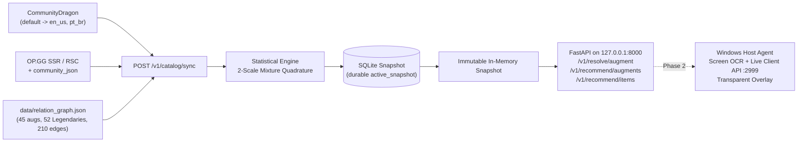

<div align="center">
  <picture>
    <source media="(prefers-color-scheme: dark)" srcset="assets/logo-dark.svg" />
    <source media="(prefers-color-scheme: light)" srcset="assets/logo.svg" />
    
  </picture>

  <h1>Riemann</h1>
  <p><strong>Statistical dynamic inference engine for League of Legends — ARAM: Mayhem &amp; Arena</strong></p>

  <p>
    
    
    
    
    
  </p>
</div>

---

## What Is Riemann?

Most League of Legends stat overlays rank augments and items using raw, unadjusted win rates — falling straight into small-sample noise (`2/2 = 100% WR`), cross-site baseline skew (e.g., Lolalytics ~51.8% vs OP.GG ~50%), sample double-counting across overlapping scrapers, and static recommendations blind to your live build.

**Riemann** separates exact game mechanics from statistical estimation:

- **Source-Centered Exact Binomial + Two-Scale Normal Mixture Posterior** — Integrates discounted, mechanically-compatible patches via convergent adaptive 3-panel Simpson quadrature ($O(h^4)$). Crushes `2/2` noise traps harder than fixed Beta shrinkage while preserving genuine heavy-tailed "Exodia" synergies (`130/200`).
- **Zero Double-Counting Across Overlapping Sources** — Selects a single primary cohort across unverified global scrapers and routes secondary overlapping feeds to same-patch corroboration and disagreement tracking.
- **Exact Physical Mechanics + Reference-Subtracted Transport** — Computes real item cooldowns $C(H) = \frac{C_0}{1 + H/100}$ (*Apex Inventor*), incremental usable vs. wasted crit + exact converter stat output (Senna/Yasuo/Yone/augments), and stateful *Weapon of Destiny* first-Legendary binding & item-transform tracking (`Winter's Approach` $\to$ `Fimbulwinter`).
- **Honest Two-Tier Uncertainty Reporting** — Exposes posterior association intervals, bias-sensitivity envelopes, `is_bias_robust_on_means`, and `is_envelope_separated` instead of faking causal certainty from marginal website aggregates.
- **Bilingual OCR Resolver (`en_us` / `pt_br`)** — Deterministic normalization + `rapidfuzz` confidence & margin thresholds to reject ambiguous or noisy screen captures cleanly.
- **Zero Outbound Network Calls on Inference** — All catalogs, relation graphs, and posteriors are precomputed into atomic SQLite snapshots and served from memory in `< 50 ms` p95.

---

## Architecture



---

## Quick Start (Docker)

The backend binds to `0.0.0.0:8000` inside the container and publishes **strictly to host loopback** `127.0.0.1:8000:8000`.

```bash
# 1. Start the local backend
docker compose up --build -d --wait

# 2. Check health (returns degraded_empty_catalog until first sync)
curl http://127.0.0.1:8000/health

# 3. Sync catalog & stats (use "cdragon" for live CommunityDragon or "fixture" for offline test data)
curl -X POST http://127.0.0.1:8000/v1/catalog/sync \
  -H "Content-Type: application/json" \
  -d '{"catalog_source": "fixture", "adapters": ["fixture"]}'
```

### Example: Dynamic Augment Recommendation

```bash
curl -X POST http://127.0.0.1:8000/v1/recommend/augments \
  -H "Content-Type: application/json" \
  -d '{
    "mode": "aram_mayhem",
    "champion_id": "jinx",
    "slot_index": 2,
    "chosen_augments": ["it_is_critical"],
    "current_items": ["infinity_edge", "phantom_dancer"],
    "offered_augments": ["jeweled_gauntlet", "ethereal_weapon", "apex_inventor"],
    "top_item_pivots_k": 3
  }'
```

### Example: Augment-Driven Item Recommendation (*Apex Inventor* / *Weapon of Destiny*)

```bash
curl -X POST http://127.0.0.1:8000/v1/recommend/items \
  -H "Content-Type: application/json" \
  -d '{
    "mode": "aram_mayhem",
    "champion_id": "dr_mundo",
    "slot_index": 1,
    "chosen_augments": ["weapon_of_destiny", "apex_inventor"],
    "current_items": [],
    "top_k": 5
  }'
```

---

## API Overview

Full OpenAPI specification is exported at [`openapi.json`](openapi.json).

| Method | Endpoint | Purpose |
| --- | --- | --- |
| `GET` | `/health` | Service status (`ok`, `degraded_empty_catalog`, `degraded_cache_reload_required`) and active `snapshot_id` |
| `GET` | `/v1/catalog/status` | Loaded patch, graph version, entity/posterior counts per mode, and per-adapter sync reports |
| `POST` | `/v1/catalog/sync` | Atomic catalog + stats ingestion, validation, posterior precomputation, and snapshot swap |
| `POST` | `/v1/resolve/augment` | Bilingual (`en_us` / `pt_br` / `auto`) fuzzy OCR resolution with confidence (`>= 0.80`) & margin (`>= 0.08`) guards |
| `POST` | `/v1/recommend/augments` | Dynamic augment ranking with physical metrics, sensitivity envelopes, and post-pick item pivots |
| `POST` | `/v1/recommend/items` | Dynamic item ranking with item haste physics, *Weapon of Destiny* lock-in state machine, and crit overcap guards |

---

## Local Development & Verification

```bash
python -m venv .venv
.venv/Scripts/pip install -e ".[dev]"

# Full unit, statistical oracle, mechanics, OCR, and Hypothesis property-based suite
.venv/Scripts/python -B -m pytest -p no:cacheprovider tests -v

# Isolated Docker E2E (loopback binding, volume isolation guard, restart persistence, p95 < 50 ms)
.venv/Scripts/python scripts/run_e2e_docker.py

# Operational live OP.GG smoke check
.venv/Scripts/python scripts/smoke_live_opgg.py
```

---

## Mathematical Model Summary

1. **Per-Source Baseline Centering:** Each binary observation `(wins, games)` is evaluated against its own source's matched champion-mode-slot baseline logit $b_p = \mathrm{logit}(\mu_{s,p,h})$ (no raw cross-site percentage mixing).
2. **Constrained Two-Scale Normal Mixture Prior:**

   $$
   g_e(\delta) = \pi\,\mathcal{N}(\delta;\,m_e,\,\tau_{\mathrm{small}}^2) + (1-\pi)\,\mathcal{N}(\delta;\,m_e,\,\tau_{\mathrm{large}}^2), \qquad \pi=0.90,\; \tau_{\mathrm{small}}=0.10,\; \tau_{\mathrm{large}}=0.50
   $$

   combined with exact discounted Binomial likelihood $q_e(\delta \mid D, \mathbf{b}) \propto g_e(\delta)\prod_p L_p(\delta; b_p)^{d_p}$.
3. **Reference-Subtracted Composite Score:**

   $$
   R_e(S) = E_q[\delta_e] + \bigl(h(S, e) - h(S_{\mathrm{ref}}, e)\bigr)
   $$

   With zero empirical data ($N_{\mathrm{eff}} = 0$), $E_q[\delta_e] = m_e = h(S_{\mathrm{ref}}, e)$ so $R_e(S) = h(S, e)$ cleanly; at $S = S_{\mathrm{ref}}$, the mechanistic delta is identically `0.0`.
4. **Two-Tier Robustness:** Reports both `is_bias_robust_on_means` (point-estimate margin after policy sensitivity bounds $B_e$) and `is_envelope_separated` (disjoint sampling + bias sensitivity envelopes).

---

## Roadmap

- **Phase 1 (Complete):** Containerized statistical inference backend, CommunityDragon + OP.GG + `community_json` adapters, curated Relation Graph, bilingual OCR resolver, and Docker E2E verification.
- **Phase 1.5 (Planned):** Google Gemini API (`google-genai`) backend integration for sync-time patch mechanics enrichment and on-demand build explanations.
- **Phase 2 (Planned):** Thin Windows host agent polling Riot's Live Client Data API (`127.0.0.1:2999`), EN/PT-BR screen capture with Gemini Vision OCR fallback, and transparent click-through overlay UI.
